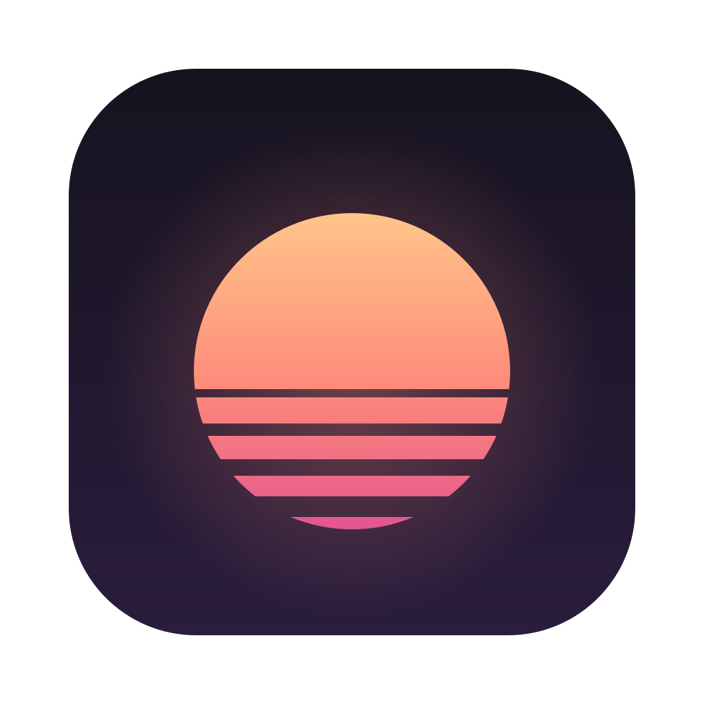
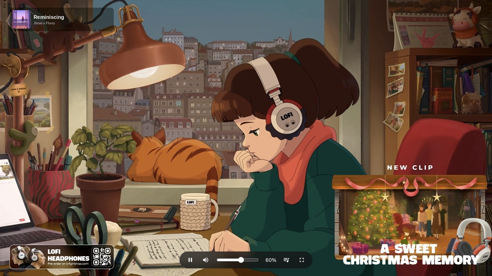
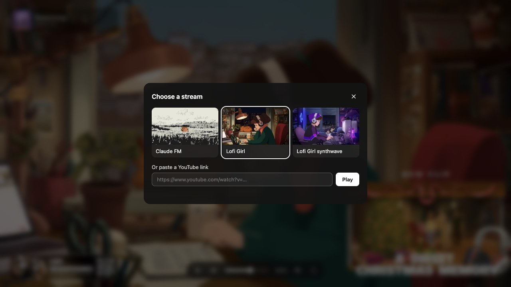

  
  <h1>ytbla</h1>
  
<b>A minimal background-music player for your second screen</b>

  
<a href="https://github.com/flyb1z0n/ytbla/releases/latest">Download for macOS, Windows, and Linux</a>

   

  

Pick a lofi stream (or paste any YouTube link) and ytbla plays it as a single clean, borderless picture: no recommendations, comments, titles, end screens, or hover overlays. It's meant to be dragged onto a second monitor, made full screen, and left playing while you work.

## Why

YouTube is a great source of music streams, but a browser tab doesn't work well as an ambient screen. It shows thumbnails, chat, and suggestions, the cursor and controls pop up whenever you hover, and it's one tab among many. ytbla turns a stream into something closer to a digital picture frame that also plays sound.

## Features

- **Nothing but the video.** YouTube's player chrome, branding, cards, and end screens are hidden. The cursor and the small control pill fade out after a couple of seconds of inactivity.
- **Built for a second screen.** Full screen opens on the display under your cursor, and the window snaps fully onto one display instead of straddling two. The window keeps a 16:9 aspect ratio when resized.
- **Curated presets.** Ships with Claude FM, Lofi Girl, and Lofi Girl synthwave. You can also paste any YouTube video, live stream, or `youtu.be` link.
- **Remembers your setup.** The last stream, volume, and mute state are restored on launch, so it starts playing right away.
- **Quiet volume control.** Scroll anywhere over the video to change the volume, with fine 1% steps while holding Shift.

  

## What it isn't

ytbla does one thing, and leaves the rest out on purpose:

- **Not a YouTube client.** There's no search, no subscriptions, no comments, and no account.
- **Not a playlist manager.** It plays one stream at a time. Switching is a key press away, but there's no queue.
- **Not a visualizer or a mixer.** The picture is whatever the stream shows, and the only audio control is volume.
- **Not busy.** Anything that would draw your eye away from work is either hidden or fades out.

## Install

Download the latest build from [Releases](https://github.com/flyb1z0n/ytbla/releases/latest):

| Platform | File |
| --- | --- |
| macOS (Apple silicon and Intel) | `ytbla-<version>-mac-universal.dmg` |
| Windows (x64 and arm64) | `ytbla-<version>-win-setup.exe` |
| Linux (x64) | `ytbla-<version>-linux-x86_64.AppImage` |

The builds are not notarized or code-signed:

- **macOS:** if the app is reported as damaged or from an unidentified developer, run `xattr -cr /Applications/ytbla.app`, or right-click the app and choose **Open**.
- **Windows:** in the SmartScreen prompt, choose **More info**, then **Run anyway**.
- **Linux:** make the AppImage executable with `chmod +x ytbla-*.AppImage`.

## Controls

| Action | Mouse | Keyboard |
| --- | --- | --- |
| Play / pause | Click the video | `Space` or `K` |
| Full screen | Double-click the video | `F` (`Esc` to exit) |
| Volume | Scroll (hold `Shift` for fine steps) | `↑` / `↓` |
| Mute | Speaker button | `M` |
| Seek ±10 s | | `←` / `→` |
| Change stream | Stream button | `S` |

## Development

See [DEVELOPMENT.md](DEVELOPMENT.md) for running the app locally, how it's put together, and how releases are published.

## License

[ISC](LICENSE)
